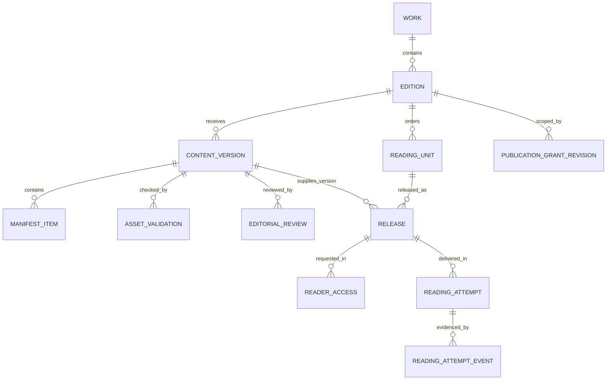
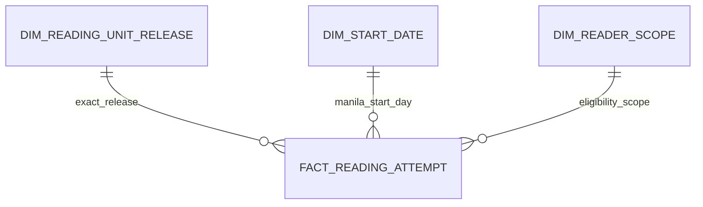

# Manga & Light Novel creator-to-reader schema

**Status** · Proposed design for review · November 19, 2026

**First verified workflow** · One independent creator, one work and edition, one approved reading unit, one authorized free read, and one reconciled local engagement report. Manga and Light Novel share the service. The first approved work can use one rendition. This design prepares the same release gates for the later publisher path. The [cross-system data map](reporting-data-map.md) places this feature in the wider sequence.

The [locked V1.0 spec](https://github.com/hilocarloarmenion03/loxadaentertainmentscompany/blob/adfd833fb60515ccf78a684778e75c6df91429cf/knowledge/specification/v1.0.md) controls business meanings. Relation names, keys, transaction boundaries and rollout choices below are design proposals. The referenced logical contracts govern additional fields and state-dependent requiredness when implementing each action. Use real, authorized identities, assets, grants and proof for application data and reports. V1.0’s classroom provider choices do not authorize live customer data or assets. Resolve that scope through the baseline change process before live capture.

## Fit with the existing Manga app

| Existing area | Design integration |
| --- | --- |
| Supabase Auth, `portal_accounts` and `staff_roles` | Reuse authenticated local account IDs and existing account status, admin entry points and staff protections. Add scoped reviewer and execution permissions for this feature. Recheck actual role, department, object and current authority inside each protected action. |
| `supplier_applications`, supplier review, invitations and private messaging | Keep the existing onboarding records and human workflow. Bind a work draft to the creator’s own application and the exact versioned application evidence. Capture immutable application revisions and a separate verification decision with reviewer authority and capacity evidence. Existing status and latest review timestamps can seed current workflow projections. A legacy `verified` label without the required evidence produces a review-needed case when it is used to execute terms. |
| Creator portal and admin workspace | Add a work and submissions area to the creator portal and rights, validation, editorial and publication actions to the authorized staff workspace. Keep Account Access, Supplier Applications and Supplier Activity available under their existing workflows. |
| Reader portal and Account Analysis | Use the reader portal as the entry point for eligible catalog and reading. Preserve permitted guest reading where scope allows. Put engagement in a separate report, using the existing reporting conventions. The account cube continues to count account records. |

Source references: [Current portal](https://github.com/lozadatech01/mangalightnovel/blob/ac5bec4b7e89faa1abcc9d6804bfbfaee8b474c6/app/portal/page.tsx) · [Supplier decision action](https://github.com/lozadatech01/mangalightnovel/blob/ac5bec4b7e89faa1abcc9d6804bfbfaee8b474c6/app/actions/admin-accounts.ts) · [Manga logical field and action contracts](https://github.com/hilocarloarmenion03/loxadaentertainmentscompany/blob/main/knowledge/specification/v1.0.md#L6533)

## Process and state gates

| Step | Actor and durable outcome | Gate or failure response |
| --- | --- | --- |
| `M-A-01`–`M-A-03` · Application and declaration | Creator saves an own application-bound work, edition, contributors and claimed rights. Authorized staff separately records a supplier verification outcome against the exact submitted application revision. | The creator can make a private draft before supplier verification. Identity conflicts and unsupported claims remain under review or held. |
| `M-A-04`, `MG-S02` · Agreement and grant | Rights reviewer prepares exact terms and assesses the requested use. Signers submit version-bound evidence. Independent verification records actual signatures and capacity. Finance and applicable authority record independent findings for the full related exposure. | Execute only against verified supplier capacity, reviewed declaration, verified signatures and valid independent findings. Required Owner decisions follow the baseline’s exact case and scope. Create or activate only the scoped grant authorized by those terms. |
| `M-A-05`, `MG-S03` · Content delivery | Creator sends a versioned chapter or reading-unit manifest and protected assets. Technical validation records the checked profile, format, order and checksums. | Require current submission permission for the creator’s edition. Invalid or unsafe assets remain rejected or quarantined. Resubmission has a new immutable content version. |
| `M-A-06`, `MG-S04` · Editorial decision | Authorized staff records approval, request for revision, rejection or hold, with reasons and feedback against the exact delivered version. | Approval requires successful technical evidence for that version and the applicable checks. A replacement must go through validation and editorial review in its own right. |
| `M-A-07`, `MG-S05`, `MG-S10` · Release | Staff plans or executes publication for an eligible unit. Record each decision and eligibility check. Review notices, withdrawal or holds against the affected use and scope. | Match the exact content version, validation, editorial approval, grant, scope and Finance evidence. Recheck at publication and at actual access. Release and grant windows are start-inclusive/end-exclusive. Preserve the historical approval and any later restriction or supersession. |
| `M-A-08`, `MG-S06` · Reader access | Trusted delivery checks exact release, current rights, region, audience and account context. A successful authorized delivery records the logical attempt. Exact final-page or end-of-text evidence records completion once. | A denied or unavailable request returns a safe outcome and creates no eligible start. Permit anonymous access only when allowed by scope. Advertising eligibility is checked separately for the same use. |
| `M-A-12`, `MG-S09` · Local report | Local analytics job reconciles one scheduled run’s eligible attempts and publishes a complete report revision for affected cohorts. | A failed, incomplete or held run retains its diagnostics and the last verified output, with source freshness shown. |

[Creator process contracts](https://github.com/hilocarloarmenion03/loxadaentertainmentscompany/blob/main/knowledge/specification/v1.0.md#L455) · [Shared Manga services](https://github.com/hilocarloarmenion03/loxadaentertainmentscompany/blob/main/knowledge/specification/v1.0.md#L1431)

## Proposed operational relations

The tables show minimum identities, references and constraint patterns for this feature. **PK** identifies a row, **FK** preserves its source relationship, and **UQ** prevents duplicate logical identities. Keep protected evidence in a local store with typed, scoped references. A status or timestamp is a projection of the evidence that supports it.

| Relation or record group | Grain, keys and main fields | Integrity and evidence |
| --- | --- | --- |
| `application_revision`, `supplier_verification` | One immutable application revision, PK `(application_id, revision)`, FK to the existing application. One verification outcome, PK `verification_id`, FK to the exact revision. Preserve applicant ownership, notice version, party/representative evidence, verification state, reasons, reviewer and authority. | Bind the decision to the still-current submitted revision at commit. Retain previous decisions and review the affected scope if verification is suspended or closed. Historical dates and evidence are preserved as known. |
| `work`, `edition`, `reading_unit` | One stable local work, one language/format/source edition, one ordered chapter or equivalent unit under that edition. Each has its own PK and a direct FK to its parent. Preserve source application revision, work kind, reviewed metadata and contributor and external-ID evidence where applicable. | Work → many editions → many units. Scope chapter/order uniqueness to the specific ordering definition within an edition. Title is display metadata. A source party may be unresolved for a private draft. Publisher identifiers later retain source party, namespace and native ID. |
| `rights_declaration_revision` | One immutable version of a rights case scoped to an edition. PK `(rights_case_id, revision)`, FK to edition. Claimants, chain of title, requested scope, state and inquiry/review evidence. | Separate claims from reviewed rights. Keep previous declarations and hold conflicts. |
| `agreement_terms_revision`, `signature_submission`, `signature_verification`, `authority_finding` | Terms PK `(agreement_id, revision)`. Bind edition, rights declaration, supplier verification, agreement kind, party capacity, signature requirements, versioned financial terms and scope. Signature submissions and verifications have separate PKs and exact-revision lineage. Independent findings reference the exact case, stage, purpose, actor/role, decision, budget/related exposure where applicable, conditions and time. | Resolve roles and applicable separation of duties at action time. Enforce state-dependent requiredness before terms take effect. Exact signature bytes or protected evidence references remain private. Use integer PHP centavos for monetary positions and retain source-authorized agreement fractions. |
| `publication_grant_revision`, `rights_event` | One versioned grant per reviewed scope. PK `(grant_id, revision)`, FK to exact signed terms and edition as required by state. Preserve rightsholder evidence, rights codes, territories, languages, channels, window, ads permission and exclusivity review. Each notice, hold, withdrawal or revision has an independently traceable record. | Require explicit permission for the affected use. Publication, translation and downstream adaptation or merchandise rights are distinct. A conflicting exclusive grant holds the affected use. |
| `content_version`, `manifest_item`, `asset_validation` | One immutable delivered version with PK `content_version_id`; bind exact edition and affected reading-unit versions through its immutable manifest. Preserve prior version, receipt, submitter, profile and protected storage reference. Manifest items use a version-scoped key and validated order, checksums and end-of-unit definition. Validation has its own PK and exact-version FK. | One delivery can contain multiple units. The initial delivery may contain one unit. The published unit points to the reviewed subset and exact version. Commit metadata only after the protected asset reference is durably verifiable. Partial or failed uploads stay held or quarantined. |
| `editorial_review`, `release`, `release_event` | A review has one exact content version and reviewed validation reference. A release binds one unit and an exact manifest/content version, selected grant revision, editorial decision, scope, schedule and applicable Finance evidence. Material content changes create a distinct immutable release version. Release events retain scheduled, published, held, withdrawn and similar outcomes. | Enforce same-edition and same-version relationships with composite keys where practical and transactional guards for cross-record gates. Eligibility needs effective evidence even when a past release event says published. |
| `reader_access`, `reading_attempt`, `reading_attempt_event` | Access request records a scoped request identity, exact release, protected viewer context and applicable notice/preferences, eligibility outcome and delivery reference when supported. Attempt has a stable PK tied to one logical reading-unit attempt for the exact release and session context. Store local reader account when authenticated, reader scope, delivery eligibility proof, start time, optional completion time and end evidence. Event history retains the V1.0 source envelope and correction references. | A trusted wrapper provides stable attempt identity across retries. Enforce one accepted start and at most one credited completion per attempt. Completion belongs to that same version and follows its start. A new deliberate attempt can be counted separately. Scope anonymous sessions locally and keep their account reference null. |

The following shows the core keys. Review decisions and downstream release events also retain the exact evidence references listed above.

Canonical field and state references: [Manga logical record dictionary](https://github.com/hilocarloarmenion03/loxadaentertainmentscompany/blob/main/knowledge/specification/v1.0.md#L6533) · [ReadingAttempt and source envelope](https://github.com/hilocarloarmenion03/loxadaentertainmentscompany/blob/main/knowledge/specification/v1.0.md#L33462).

## Transaction, authorization and privacy design

- Write an accepted transition and its evidence together. Lock or version-check the affected case/record when an approval could race a revision, a publication could race a hold, or duplicate requests could create two reading effects. A repeated operation with identical scope and content returns the original result. The same identity with divergent content records a conflict. Retain the original result and correction lineage.
- Resolve publication and reading eligibility server-side against actual current records. Use a protected delivery grant with the necessary recheck or revocation behavior. A client-provided success flag, a successful eligibility check before delivery, and a page refresh each provide insufficient evidence of an eligible start. Implement trusted delivery acknowledgment against the approved content-delivery source. Persist accepted delivery evidence and its start in one local transaction. Recover interrupted acknowledgment using the same attempt identity. Keep an access denial or incomplete delivery separate from engagement.
- Keep evidence and raw analytics in restricted local schemas and private storage. Grant schema/table/function access explicitly and apply row-level access controls where exposed. Creators can see their own work and feedback, scoped staff can exercise independently authorized actions, and readers receive only currently eligible public projections and their own permitted interactions. Use trusted role assignments and protected APIs. Separate viewing, review, Finance, and publication writes. Index FK and scope predicates used by the actual queries. Validate permissions and concurrency on the target Postgres version before migration.
- Keep raw attempt and interval evidence under the 90-day activity policy. Design a restricted local reader reference that supports scoped distinct counts and controlled erasure. Keep security diagnostics and protected operational, rights and financial proof under their applicable classes. After raw data expires, retain permitted reconciliation proof and previously verified aggregates. Mark exact recomputations unavailable when permitted surviving data cannot support them.

[Baseline privacy and retention](https://github.com/hilocarloarmenion03/loxadaentertainmentscompany/blob/main/knowledge/specification/v1.0.md#L34531) · [Supabase Data API and grants](https://supabase.com/docs/guides/api/securing-your-api)

## Manga engagement mart

| Model | Proposed structure |
| --- | --- |
| **Star** | `fact_reading_attempt` has one authorized delivered attempt, joined many-to-one to `dim_reading_unit_release`, `dim_start_date`, and `dim_reader_scope`. The flattened release dimension carries work, edition, reading unit and exact release keys plus usable labels. Start and optional completion instants remain separate. A restricted local reader key supports distinct computation. Include provenance and fixture scope. |
| **Snowflake** | Normalize the release dimension into work → edition → reading unit → exact release version, and the Manila calendar into year → quarter → month → day where the analytical model needs it. The attempt retains one exact release FK and one start date FK. Match historical label revisions to the as-of policy when labels change. |
| **Galaxy** | Later add provider settlement and creator allocation facts with their own grains. Share conformed dimensions only where definitions match. Make settlement and cohort date roles explicit. A work link for advertising is valid only where an allocation has verified work attribution. Keep statement totals safe from row multiplication across beneficiaries, titles and attempts. |

### Load and publish

1. Incrementally discover new and revised attempts using recorded-time checkpoints with a stable tie-breaker or an equivalent durable cursor. Keep the original UTC start and completion instants. Determine affected partitions using the original start in Asia/Manila. A late completion or reviewed correction can restate that earlier cohort.
2. Validate exact release linkage, eligibility evidence, source uniqueness, local reader scope, notice/fixture context and completion linkage. Quarantine conflicts for review. Filter the approved population to eligible signed-in attempts, excluding marked nonproduction bot/test/staff fixtures. Keep invented activity out of the application and its report data.
3. Produce `manga_title_engagement_monthly` at **work × Manila start-cohort month × `SIGNED_IN_ELIGIBLE_V1`**. Count starts once per eligible attempt, completions once per counted start at the exact required end, and distinct local reader accounts within that row. Compute completion rate as completions ÷ starts, with a zero denominator producing not applicable. Keep guest reads outside that signed-in population.
4. Compare report components with deduplicated source evidence before publishing an atomic complete partition revision. Retain run ID, source cutoff, input and output counts, diagnostics, definition version, freshness, and prior/current revision references. Rebuilding a valid empty partition can replace a previous result. A failed run preserves the prior verified result with its original freshness.
5. Slice by work or a time member, dice across supported works and periods, drill through the time hierarchy, and pivot dimensions without changing the filtered population. Show finer local release breakdowns only under a separately explicit scope with authorized supporting attempt rows. Calculate distinct roll-ups from permitted detailed evidence. HQ exports preserve the approved row grain and disclosure rules, including withholding positive cohorts below ten distinct accounts. Validate small positive cohorts against the same local evidence and keep their HQ export withheld.

[Exact R2 dataset and measure rules](https://github.com/hilocarloarmenion03/loxadaentertainmentscompany/blob/main/knowledge/specification/v1.0.md#L34168) · [OLAP reporting standard](olap-reporting.md)

## Acceptance before a production migration or report claim

| Case | Expected evidence or result |
| --- | --- |
| Own private draft before supplier verification, then a revised application | Draft stays private. Contract execution waits for verified capacity and exact current reviewed evidence. A stale review cannot approve the revision. |
| Missing signature, wrong purpose, or requester acting as independent approver | Hold or deny with the correct reason. No executable terms or publication grant. |
| Changed file after validation or after editorial approval | The new version has its own validation and review. The previous approval remains linked to the original version. |
| Scheduled release with a revoked, expired or mismatched grant | Actual publish or access is blocked for the affected use. At the exact end instant, authorization has expired. A denied delivery adds no successful start. |
| Same delivery retry twice, second deliberate attempt, foreign completion request | One start for the repeated attempt and a distinct start for the legitimate new attempt. A foreign or wrong-version completion adds no credit. |
| Completion crosses the Manila month boundary | The original month gets at most one completion for that start, the next month gets no duplicate start, and replaying the load produces the same counts. |
| Two authorized accounts with three observed starts and two completions | The matching local report yields **3 starts, 2 completions, 2 distinct accounts, 66.7%**. A denied request and a retry do not increase the expected total. A guest attempt stays outside the signed-in cohort. |
| Pivot, roll-up and interrupted refresh | Matching additive measures reconcile before and after pivot. Distincts are recomputed when evidence permits. A failed refresh shows its state and retains the previous verified revision. |
| Approved and withheld HQ cases | An independently approved eligible aggregate can load once. A small positive cohort is withheld across rows, derived rates, complementary totals and revealing metadata. Corrected content requires its own approval. |

**First migration sequence after review:** verify current signed-in onboarding and hosted schema, confirm scoped Rights/Editorial/Finance/Owner reviewer assignments and publication permissions, add source capture and protections, implement creator-to-reader, reconcile the local mart, then test a separately approved HQ transfer. Before SQL, settle hosted schema compatibility, exact trusted delivery acknowledgment, review and storage policies, and the approved content, territory and audience scope. Reuse the V1.0 approval and privacy rules when resolving those implementation choices. Record the first observed evidence and verification outcome in the [implementation diary](diary.md).
